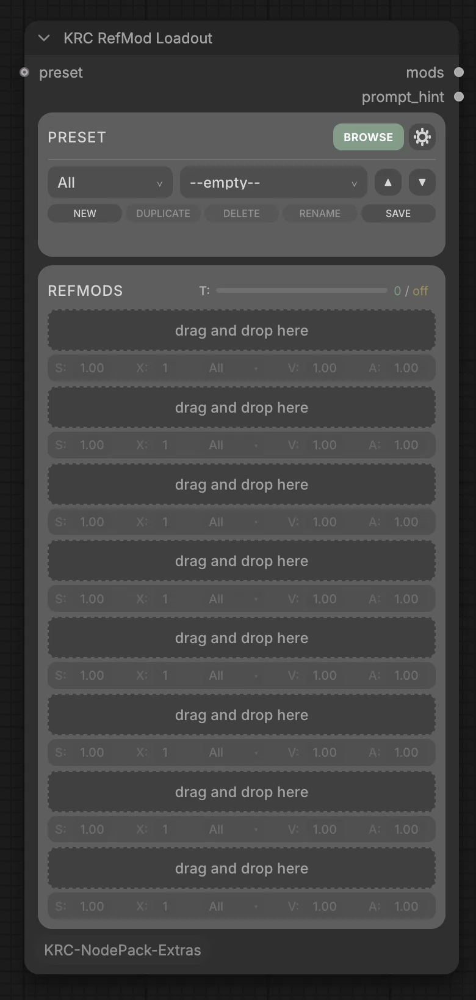
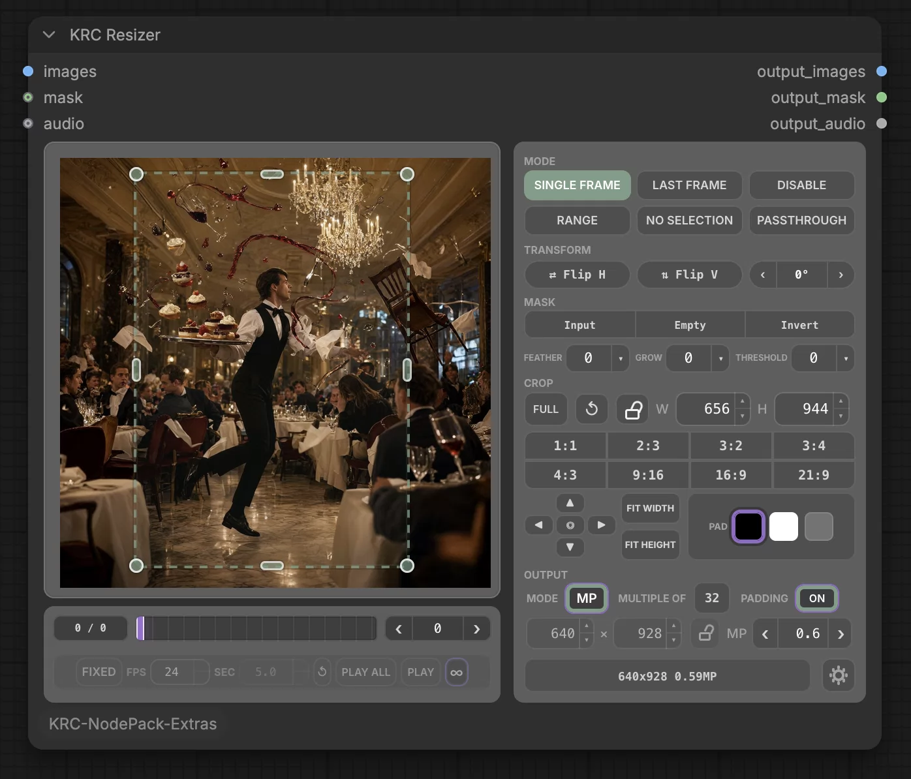

# KRC NodePack Extras

More ComfyUI nodes built on [KRC NodePack](https://github.com/kapakahi/KRC-NodePack).
They use NodePack's library, cards, presets and styling, so install NodePack first.

## KRC RefMod Loadout

<a href="https://raw.githubusercontent.com/kapakahi/KRC-NodePack-Extras/main/docs/images/refmod_loadout.webp"></a>

A card-based loader for MiniMax H3 RefMods. Fill eight slots from the KRC Portal, set
each one's strength, and watch the token meter (with an optional budget). Save stacks as
presets.

- **Needs** [ComfyUI-MiniMaxH3Mod](https://github.com/Luisacaotica/ComfyUI-MiniMaxH3Mod).
  Put RefMod files in `models/refmods`.
- **Outputs** `mods` and `prompt_hint`, ready for Apply H3 RefMod and H3 RefMod Text
  Encode.

## KRC Resizer

<a href="https://raw.githubusercontent.com/kapakahi/KRC-NodePack-Extras/main/docs/images/resizer.webp"></a>

Crop, pad, resize and mask images with a live preview. Handles image batches, and can
pass through or switch itself off.

## KRC Frame Router

Sends a single frame out `image` and a batch of frames out `video`. Made for MiniMax H3
**Reference to Video**: wire `image` to its reference image and `video` to its reference
video, and a still or a clip from the same Resizer lands in the right place.

## Installation

You need [KRC NodePack](https://github.com/kapakahi/KRC-NodePack) installed.

### ComfyUI Manager

Open **Manager ▸ Custom Nodes Manager**, search for **KRC NodePack Extras**, click
**Install**, and restart ComfyUI. Install **KRC NodePack** the same way first if you
don't have it yet.

> **Just released:** if Manager shows no installable version of KRC NodePack yet, the
> Comfy Registry is still reviewing it. Install it by hand for now, as its
> [README](https://github.com/kapakahi/KRC-NodePack#manual-install) shows.

### Manual install

```
cd ComfyUI/custom_nodes/
git clone https://github.com/kapakahi/KRC-NodePack-Extras.git
```

Restart ComfyUI. The nodes are under the **KRC NodePack Extras** category.

## License

Released under the [GNU General Public License v3.0](LICENSE).
